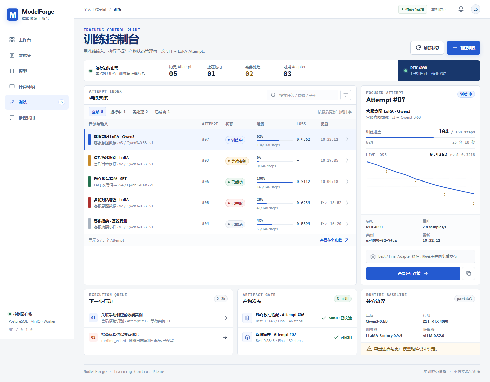
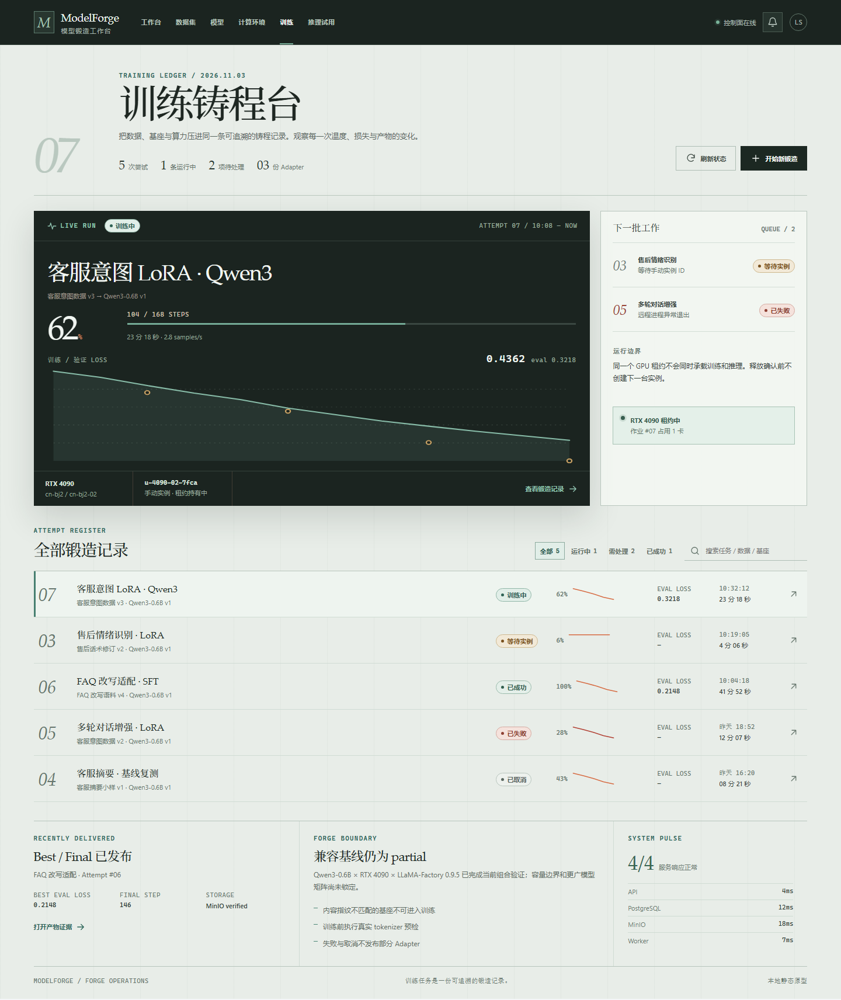
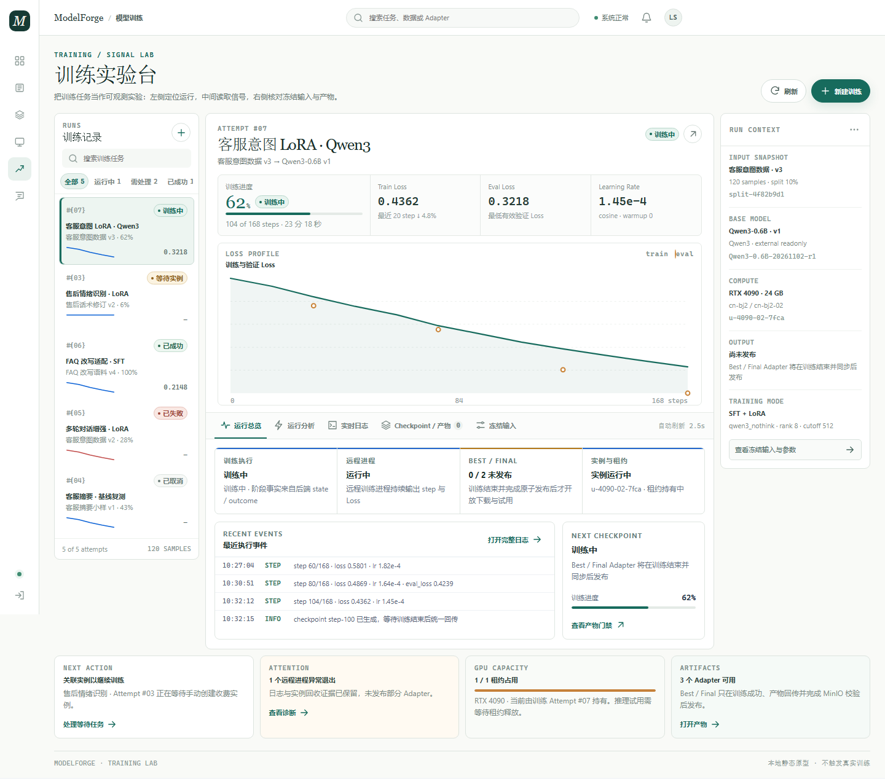

# ModelForge 训练模块 UI 重设计报告

> 日期：2026-11-03
> 设计角色：产品体验 / 信息架构 / 视觉设计 / 前端设计工程
> 性质：**静态设计探索与高保真原型**，不是生产实现，不是训练验收
> 推荐方向：**B2 · 训练工作台**（保留 B 的信息架构，接回 ModelForge 统一工作台视觉语言）

---

## B2 增补：在 B 基础上的深度优化

### B2.1 为什么不是继续打磨原 B

用户评审指出：原 B 与数据集、模型、计算环境等模块不像同一个产品。这个判断成立，原因不是“颜色不够蓝”，而是 B 使用了另一套产品壳层与视觉语法：

- 深色横向顶栏替代了现有左侧工作台导航；
- Georgia / Songti 衬线标题与数字替代了现有系统无衬线；
- 暖石灰、铜色与纸面网格替代了现有浅灰页面与白色面板；
- 8–10px 的“账本式微字”承担了实际功能信息；
- “训练铸程台 / 锻造单 / 锻造记录”等隐喻超出产品日常语言。

B2 因此保留 B 的业务骨架，只重建它的表达层。

### B2.2 保留了什么

| 业务资产 | B2 状态 |
|---|---|
| 当前运行主舞台 | 保留，继续作为首屏第一视线 |
| 阶段生命周期 | 保留，成功态改为真实完成时间，避免与“已成功”冲突 |
| Loss 曲线 | 保留，收敛到局部深色数据面，成为页面唯一深色主角 |
| Attempt 账本 | 保留，改为可读性更高的白底表格 |
| 待处理事项与 GPU 租约 | 保留，放在当前运行右侧 |
| 四步创建与冻结预览 | 保留，改为标准工作台表单与粘性摘要 |
| 运行详情五页签 | 保留并扩展：运行总览、运行分析、日志、Checkpoint / 产物、冻结输入 |
| Best / Final 2 / 2 发布门 | 保留，成功与未发布状态分别验证 |
| 证据侧栏 | 保留，使用标准卡片和状态标签 |

### B2.3 具体改了什么

1. **页面壳层统一**：改为 232px 左侧导航 + 64px 顶栏 + 浅灰工作区，与 ModelForge 其他模块一致。
2. **主操作统一**：所有主按钮使用 `#245ad0`，次级操作使用白底细边框，危险操作只在取消训练时出现。
3. **字体统一**：移除衬线字体，标题、标签、按钮和正文均使用系统无衬线；数字仅保留 Consolas 等宽。
4. **层级重整**：页面标题从 38–68px 收回到 28px；当前 Run 标题 20px；正文 13px；功能辅助信息控制在 10–12px。
5. **深浅关系重整**：整页白底，深色仅用于 Loss 曲线和日志控制台，不再把整页压成黑绿色。
6. **表格可读性**：固定列网格、提高行高、使用状态 pill、进度条和等宽数字；移除装饰性 sparkline。
7. **Loss 图重做**：增加 Loss 纵轴刻度、Step 横轴、当前步参考线、train / eval 双趋势线、首尾值、验证最优点与趋势结论；无采样时显示明确空态。
8. **表单标准化**：输入框从“下划线账本”改为标准 39px 高控件、统一标签与 3px 蓝色聚焦环。
9. **响应式重排**：390px 下侧栏变横向导航，主内容单列，表格行改为两列卡片式信息行；B2 文档宽度保持等于视口。
10. **文案收敛**：删除“铸程台 / 锻造单 / 锻造记录 / 出品封印”等系统性隐喻，改为“训练工作台 / 新建训练 / 运行证据 / 产物门禁”。
11. **运行诊断升级**：工作台增加 Learning Rate、Gradient Norm、显存与吞吐的轻量健康摘要；详情页新增“运行分析”页签，提供四张带刻度与阈值的诊断图，并按 step 排列验证、裁剪、Checkpoint 与当前采样事件。
12. **数据诚实边界**：任务级 accuracy / F1 未上报时只显示“尚未上报”说明，不生成推断曲线；等待实例和失败 / 取消任务使用各自空态。

### B2.4 设计 token

```css
--page:        #f6f8fb;
--surface:     #ffffff;
--surface-subtle: #fbfcfe;
--line:        #dfe5ed;
--line-strong: #ccd5e1;
--ink:         #172033;
--ink-2:       #354158;
--muted:       #667386;
--blue:        #245ad0;
--blue-dark:   #1b47a7;
--blue-soft:   #edf3ff;
--success:     #247553;
--warning:     #9b6512;
--danger:      #b23a37;
--dark:        #111a29;
```

- 字体：`"Segoe UI", "Microsoft YaHei UI", "PingFang SC", sans-serif`
- 数字：`Consolas, "SFMono-Regular", monospace`
- 圆角：卡片 8px，表单控件 6px，进度条 999px
- 间距：页面区块 14px，卡片内边距 14–18px，表格行高 61px
- 阴影：以细边框为主；按钮仅保留 0–2px 的轻阴影

### B2.5 组件拆分建议

```text
TrainingWorkspace
├── WorkbenchShell / AppSidebar / Topbar
├── TrainingPageHeader
├── TrainingSummaryStrip
├── CurrentRunPanel
│   ├── RunProgress
│   ├── RunMetricFacts
│   ├── LossPanel
│   ├── TrainingHealthStrip
│   └── RunResourceFooter
├── AttentionQueue
├── ResourceLeasePanel
├── AttemptTable / AttemptRow / AttemptStatus
├── CreateTrainingStepper
├── FrozenManifestPanel
├── RunDetailHeader
├── LifecycleTrack
├── RunDetailTabs
├── RunAnalysisPanel
│   ├── MetricTrendCard × 4
│   └── AnalysisEventTrace
├── EvidencePanel
├── LogConsole
└── ArtifactGate / ArtifactCard
```

### B2.6 前端落地顺序

1. 先抽出工作台 token 与基础按钮、状态标签、表单控件，不先改页面。
2. 接入左侧导航和页头，验证训练页与其他模块的壳层一致。
3. 实现当前 Run 主卡、Loss 数据面和右侧待处理区。
4. 实现 Attempt 表格，明确状态、进度、Loss、更新时间的稳定列宽。
5. 重构四步创建表单，接入既有校验与冻结字段。
6. 重构详情页四页签，先做证据侧栏和生命周期，再迁移日志与产物。
7. 最后补齐 1280 / 390 断点、键盘焦点、空态与错误态。

### B2.7 实际验证

- 1440、1280、390 均实际渲染并检查截图；B2 页面无整页横向溢出。
- `b2:overview:1440`、运行分析、创建、详情、日志、产物与成功产物等页面场景均通过渲染检查。
- 创建页校验错误会获得焦点，字段同步 `aria-invalid` 与 `aria-describedby`。
- 提交模态框具备 `inert` 背景、Tab 焦点循环、Escape 关闭和触发按钮焦点恢复。
- 日志筛选、工作台行点击、取消确认与创建提交流程均实际走通。
- 浏览器 console / page errors 为 0。
- `audit-ui.mjs`：B2 最低实际文字为 11px，段落 / 列表不低于 12px；390px 文档、表格和创建布局均无横向溢出。
- `impeccable detect`：B2 HTML 与 CSS 均返回 0 findings。

### B2.8 当前限制

- B2 仍是静态原型，没有接入真实训练 API、SSE 日志或真实指标轮询。
- 运行状态、Loss、Checkpoint 与 Adapter 为合理示例数据，不代表端到端训练验收。
- 长日志虚拟化、200% 浏览器缩放、屏幕阅读器完整朗读与真实数据下的列宽抖动仍需在生产实现阶段复验。
- 推荐先评审 B2，再进入 `frontend/src/features/training` 的正式组件化实现；本轮不覆盖生产代码。

---

## 0. 原始三方向结论（历史，保留）

当前训练页的核心问题不是“蓝色后台不好看”，而是任务、执行、产物与资源四类事实被压在同一个长页面中。页面既像创建向导，又像 Attempt 列表，又像运行监控页，最终每一种工作都缺少明确的第一视线。

本轮把训练模块重新组织为：

```text
训练任务总览
├── 当前运行 / 待处理 / 产物 / 兼容边界
├── Attempt 账本与筛选
└── 新建训练（独立四步）

Attempt 详情
├── 运行总览
├── 实时日志
├── Checkpoint / 产物
└── 冻结输入
```

三套视觉语言共享同一业务底线，但侧重点不同：

| 方向 | 一句话定位 | 第一主角 | 适用场景 |
|---|---|---|---|
| A · 运行控制墙 | 异常在哪一步发生，就在哪一步处理 | 操作、门禁、日志和成本 | 高频值守、故障处置 |
| **B · 铸程台** | 一次训练是一件逐步成形并可验收的作品 | 生命周期、曲线和产物 | 观察、等待与验收单次训练 |
| C · 证据画布 | 先看数据形状，再决定下一步 | 真实曲线和运行比较 | 指标阅读、参数迭代 |

在原始 A / B / C 对比中推荐 B。它最贴近当前单用户、本机优先、强调可追溯性的产品定位，也最自然地承载长时段训练需要的“回来重建上下文、观察、验收”动作。用户评审后确认 B 的视觉语言与产品其他模块不一致，因此最终推荐已更新为上面的 **B2 · 训练工作台**。

---

## 1. 审查依据与方法

### 1.1 实际检查范围

- 当前页面：[`frontend/src/features/training/Training.tsx`](../../frontend/src/features/training/Training.tsx)
- 顶层路由：[`frontend/src/app/App.tsx`](../../frontend/src/app/App.tsx)
- Adapter 资产组件：[`frontend/src/features/models/AdapterAssets.tsx`](../../frontend/src/features/models/AdapterAssets.tsx)
- 数据集与模型证据页：[`frontend/src/features/datasets/Datasets.tsx`](../../frontend/src/features/datasets/Datasets.tsx)、[`frontend/src/features/models/Models.tsx`](../../frontend/src/features/models/Models.tsx)
- 工作台及共享样式：[`frontend/src/shared/styles/workbench.css`](../../frontend/src/shared/styles/workbench.css)
- 手动实例与计算状态：`frontend/src/features/resources/`
- 训练执行与兼容基线：`backend/src/modelforge/modules/training/`、`backend/src/modelforge/runtimes/`
- 规格与边界：`AGENTS.md`、`docs/PROJECT_BRIEF.md`、`docs/ARCHITECTURE.md`、`<internal-evidence>`

### 1.2 当前页截图方式

本机没有启动真实 API、Worker、PostgreSQL、MinIO 或 GPU。为了看到真实 React 页面的排版，当前截图使用 Vite 页面 + mock `/api/v1` 响应：

- [当前训练总览](./review/current/training-overview-1440.png)
- [当前 Attempt 详情堆叠](./review/current/training-detail-1440.png)

这证明截图来自真实前端组件，但**不代表真实训练数据**或端到端可用性。

### 1.3 子代理与汇总方式

- 子代理 A：体验与信息架构诊断，产出 8 条证据化问题、目标路由、四步创建与详情分域、状态红线。
- 子代理 B：视觉方向探索，产出 A / B / C 三种不同首屏主角与视觉语言，并推荐 B。
- 主负责人：重新对照实际页面与截图，横向比较后决定最终实现版本；没有机械拼接三套方案。

子代理原始记录保留在：

- `<internal-evidence>`
- `<internal-evidence>`

---

## 2. 具体问题诊断

### 2.1 创建、列表和详情同屏堆叠，页面没有真正的主任务

**证据**

- 页面在标题之后立即展示四步创建表单。
- 创建区之下直接接 Attempt 列表。
- 选中 Attempt 后，产物、指标、运行报告、日志和冻结快照继续纵向堆叠。
- 顶层只有 `#training`，没有新建页和 Attempt 稳定深链。

**影响**

未提交的草稿、已经发生的运行和即将处理的异常共享同一条长页面。用户刷新后丢失选择与表单，也无法从工作台异常直达对应 Attempt。

**设计响应**

把 `训练总览 / 新建训练 / Attempt 详情` 拆成三个工作上下文；详情继续分页签。所有主操作拥有稳定 URL。

### 2.2 Task 与 Attempt 层级被压平，列表不知道“我现在该做什么”

**证据**

- 当前表头主要是：任务、Attempt、状态、阶段、操作。
- 缺少数据版本、实例、产物可用性、最后更新、错误原因和明确下一步。
- 阶段直接显示英文后端代码。
- 终态行仍可能显示“创建重试 Attempt”，动作与状态弱关联。

**影响**

“等待手动实例”“训练中”“同步失败”“实例未清理”被平铺成状态词，用户需要点开每一行才能判断风险与动作。

**设计响应**

总览以 Task 为第一层、Attempt 为第二层；账本直接展示输入身份、状态、进度、指标、更新时间和唯一主动作。异常行带精确深链。

### 2.3 “看似自由配置”与实际单一兼容基线冲突

**证据**

- 计算环境步骤开放地域、可用区、GPU、CPU/内存、镜像、系统盘和计费方式。
- 当前后端只存在一组已启用组合；除 seed 外，参数与硬件要求精确匹配。
- 参数页以普通数字输入呈现，但绝大多数 disabled，没有明确区分“锁定值”和“可调值”。
- 模型不兼容只显示“未支持”，缺少具体原因。

**影响**

用户会先花时间配置一套实际不可提交的组合，最后才收到拒绝；在视觉上也很难理解“可调”到底意味着什么。

**设计响应**

配置页首先展示已验收 blueprint，不把目录字段包装成自由选择；锁定参数用只读摘要，seed 单独标注为可调；不兼容原因就地解释。

### 2.4 `state + stage` 无法说明“真的完成了吗”

**证据**

- 前端只显示训练 state 和后端 stage。
- 实际执行还包含 outcome、退出码、租约、实例清理等独立事实。
- 取消过程中，进程退出、停止实例和释放租约不是同一个事件。

**影响**

“训练成功”可能被误读成“产物可用”“实例已清理”“推理资源已释放”。失败与清理失败也可能被埋在资源模块。

**设计响应**

所有方案统一增加四类并列事实：

1. 训练执行
2. 远程进程退出
3. Best / Final 发布
4. 实例与租约清理

成功色只用于后端已确认事实，不用于“看起来应该没问题”。

### 2.5 Best / Final 的原子发布门禁没有在 UI 中成立

**证据**

- 没有产物时统一显示“尚无 Best / Final Adapter”，无法区分训练中、同步中、失败或同步异常。
- 两张卡分别判断自己的 `row.state`。
- “用于推理试用”入口没有检查产物可用性，也不携带明确 Adapter 身份。
- 后端实际要求 Best 与 Final 都完成写入与回读校验后才一起可用。

**影响**

用户可能从同步中的产物进入推理页，最后才在另一模块看到失败；也无法确认试用的是 Best 还是 Final、对应哪次冻结输入。

**设计响应**

先展示组级发布门禁，再展示两张资产卡。只有 `2 / 2 可用` 且训练实例已释放时才开放“准备推理试用”，并携带精确 Adapter ID。

### 2.6 指标和日志仍是原始数据倾倒

**证据**

- 指标以 Step / Epoch / 训练 Loss / 验证 Loss 表格为主，没有曲线、Best 点或空值说明。
- 详情轮询反复读取整段日志；达到读取上限时没有截断提示。
- 日志放入单个 `<pre>`，缺少跟随、暂停、搜索、跳最新和下载。
- 日志 gap 只有整体警告，无法知道缺口位置。

**影响**

长时间训练的成本与浏览器负担随日志增长；用户无法观察趋势、验证点和异常前后文，也容易把“未采样”误认为“训练异常”。

**设计响应**

曲线作为主视读层，原始表作为折叠证据；验证点不插值。日志使用增量尾部控制台，明确跟随、搜索、截断、缺口和采集截止时间。

### 2.7 首次加载、空数据、筛选无结果、过期和局部失败混为一体

**证据**

- Attempt 初始数组为空，首次请求尚未返回就显示“暂无训练任务”。
- 列表、输入、详情和日志共用一个页面级 error。
- 非关键请求失败可能让页面只剩错误，旧数据又会继续显示且没有“已过期”标记。

**影响**

用户无法判断是正在加载、确实没有任务、筛选无结果、服务不可用，还是当前数据已经过期。

**设计响应**

列表、详情摘要、指标、日志、产物、实例分别拥有加载 / 空 / 过期 / 局部错误状态。页面级错误只处理真正阻断整页的问题。

### 2.8 冻结输入与审计证据以原始 UUID / JSON 倾倒

**证据**

- 详情头部展开完整 UUID、实例 ID、错误码、基座指纹和拆分摘要。
- 冻结配置常以原始 JSON 出现，缺少人类可读摘要。

**影响**

真正需要一眼确认的“数据版本、样本数、拆分、基座身份、兼容 preset、手动实例规格”被机器字段淹没。

**设计响应**

首屏使用可读摘要和短指纹；完整 UUID、SHA-256、snapshot、runtime report 进入折叠审计区。

---

## 3. 目标信息架构

### 3.1 三个独立上下文

| 路由语义 | 回答的问题 | 主要动作 |
|---|---|---|
| `#overview` / Task 总览 | 现在有哪些训练，哪一条需要我 | 新建、筛选、处理异常、进入详情 |
| `#create` / 新建训练 | 这次训练要冻结什么 | 四步确认、校验、提交 |
| `#detail` + Attempt 详情 | 这次执行走到哪里、产出了什么 | 绑定实例、看日志、验收产物、安全取消 |

### 3.2 四类状态必须并列

```text
训练执行：排队 / 等待实例 / 准备 / 训练中 / 同步中 / 回收中 / 已结束
远程进程：未启动 / 运行中 / 已退出 exit N / 状态未知
产物发布：0/2 / 1/2 不发布 / 2/2 可用 / 同步失败
实例租约：未创建 / 已绑定 / 运行中 / 清理中 / 清理失败 / 已释放
```

界面应让用户同时看到它们，而不是用一个“健康/失败”徽标合并。

### 3.3 创建流程

1. **任务与输入**：名称、已发布数据版本、已验证基座。
2. **执行边界**：唯一兼容 blueprint、手动收费实例、镜像与计费。
3. **训练参数**：固定 preset 摘要；seed 为唯一可调参数。
4. **确认提交**：可读摘要、冻结快照、不会购买资源、进入等待实例。

---

## 4. 三套设计方向

### 4.1 A · 运行控制墙 / Forge Control



#### 设计概念

**异常在发生的那一步被看见，并在同一视线内处理。**
关键词：控制面、门禁、运行索引、日志、成本、命令式。

#### 适用场景与目标用户

- 高频操作付费 GPU、习惯看日志和进程状态的开发者。
- 需要持续值守、及时发现日志异常、实例未绑定和租约未释放。
- 桌面宽屏优先，接受更高信息密度。

#### 信息架构与页面布局

- 顶部横向概况条显示历史 Attempt、运行中、需处理、Adapter 和 GPU 租约。
- 主区是紧凑 Attempt 索引，右侧是当前运行检查器。
- 下方分成“下一步行动 / 产物发布 / 兼容边界”。
- 详情页左侧为 tab 内容，右侧为执行证据。

#### 关键交互

- 筛选与搜索直接作用于账本。
- 行选中后右侧检查器即时切换。
- 日志使用深色控制台，状态与门禁始终可见。
- 取消使用安全回收确认，明确进程、实例和租约三步。

#### 视觉规则

- 色彩：白纸工作区、深钴蓝主操作、石墨文字、绿/琥珀/红语义色。
- 字体：Bahnschrift / Segoe UI + Cascadia Code 数字。
- 间距：4px 基础网格，紧凑表格行，强边界线和低圆角。
- 图表：训练曲线作为诊断图，不喧宾夺主。
- 动效：100–180ms，开关式；不使用持续脉冲。

#### 亮点与取舍

- 亮点：信息效率最高，异常和成本最醒目；最接近计算环境页的操作语汇。
- 取舍：弱化“作品成形”的产品叙事，情绪更冷；容易滑向通用运维后台。
- 适用：高频值守、故障处置。
- 风险：中文密集小字和深色日志对低分辨率不友好；需要虚拟化与更严格密度控制。

更多截图：

- [运行详情](./review/a/detail-overview-1440.png)
- [创建页](./review/a/create-input-1440.png)
- [日志页](./review/a/detail-logs-1440.png)
- [成功产物](./review/a/detail-succeeded-artifacts-1440.png)

---

### 4.2 B · 铸程台 / The Forge Run（推荐）



#### 设计概念

**训练像一件逐步成形、可验收的作品；曲线与产物是终点。**
关键词：生命周期、炉程、Loss 曲线、出品门、冻结证据、冷石灰与氧化铜。

“锻造”只作为结构与动词，不使用火焰、铁砧、羊皮纸纹理等装饰。

#### 适用场景与目标用户

- 愿意观察训练过程、需要判断“是否继续等待”的独立开发者和小团队研究者。
- 用户会离开页面再回来，希望一眼重建运行阶段、当前产出和下一步。
- 适合作为 ModelForge 的训练模块主叙事，而不是批量实验管理平台。

#### 信息架构与页面布局

- 上方展示当前活跃运行：标题、进度、真实 Loss 和实例。
- 中央是横向生命周期轨道：提交 → 准备 → 执行 → 同步 → 回收。
- 左/下方进入 Attempt 账本和筛选。
- 右侧队列显示等待实例与失败待处理。
- 运行详情以深色主舞台 + 大 Loss 曲线开场，下方是四类状态和最近日志。

#### 关键交互

- 从账本选择运行后，当前主舞台和右侧证据同步切换。
- 四步创建使用连续“锻造单”，左侧步骤、中央表单、右侧冻结预览。
- Best / Final 以出品门表达；2 / 2 可用后才开放推理试用。
- 取消使用“安全回收”文案，分别说明进程退出、实例删除、租约释放。

#### 视觉规则

- 色彩：冷石灰画布 `#e8ede8`、石面 `#f5f8f4`、石墨 `#1b2420`、氧化铜/青绿 `#2f6d62`、成功绿 `#3f6f5e`。
- 字体：Iowan Old Style / Palatino / Noto Serif SC / Songti SC 大标题，Segoe UI / Microsoft YaHei UI 正文，Cascadia Code 数字。
- 间距：4px 基础；账本紧凑，曲线与出品门有更大留白。
- 组件：方角记录、细分隔线、冷石面层级；不使用玻璃拟态或大面积渐变。
- 图表：真实训练线 + 稀疏验证点；Best 由证据标注，不伪造平滑验证线。
- 动效：220–320ms ease-out；像轨道推进和证据落位，不做烟花或火焰。

#### 亮点与取舍

- 亮点：产品辨识度最强；生命周期、曲线和产物验收天然共处一个画面。
- 取舍：比 A 留白多，单位屏幕信息量略低；衬线展示必须严格限制在标题和终态。
- 适用：单次训练观察、回到页面继续判断、最终产物验收。
- 风险：如果加入火焰/做旧纹理会变成主题乐园；展示衬线与冷石色如果使用过量，会抢走日志和表单的操作优先级。

更多截图：

- [运行详情](./review/b/detail-overview-1440.png)
- [创建页](./review/b/create-input-1440.png)
- [表单校验错误](./review/b/create-validation-error-1440.png)
- [提交确认模态框](./review/b/submit-modal-1440.png)
- [日志页](./review/b/detail-logs-1440.png)
- [成功产物页](./review/b/detail-succeeded-artifacts-1440.png)
- [1280 总览](./review/b/overview-1280.png)
- [390 窄屏](./review/b/overview-390.png)

---

### 4.3 C · 证据画布 / Evidence Lab



#### 设计概念

**先看数据形状，再决定下一步。**
关键词：证据、曲线、运行索引、真实空值、象牙白与深青绿。

#### 适用场景与目标用户

- 迭代型开发者、研究者或参数调优者，需要在多次运行之间阅读差异。
- 希望左侧快速定位运行，中间读曲线，右侧核对冻结输入。
- 适合桌面分析工作，实例和日志退到按需层级。

#### 信息架构与页面布局

- 64px 图标 rail。
- 左栏 Run List，中央 Inspector，右栏 Context。
- Inspector 顶部是进度与四项指标，中央大曲线，下方页签与证据。
- 下方条带显示下一步、异常、GPU 容量和产物。

#### 关键交互

- 运行列表与中央曲线同步选择。
- 日志作为可搜索的深绿控制台。
- 产物以 BEST / FINAL 两卡并排，Checkpoint 作为来源证据。
- 创建页更轻，使用连续四步与右侧 manifest。

#### 视觉规则

- 色彩：象牙白、白画布、墨绿黑、深青绿主色、杏橙第二系列、极细边线。
- 字体：Inter / Segoe UI Variable + IBM Plex Mono / Cascadia Code。
- 间距：8px 网格，数据密、外围静；极少阴影。
- 组件：轻边框、低圆角、图表与矩阵共享选择状态。
- 图表：大尺寸、稳定轴、真实点；支持未来同口径比较。
- 动效：160–240ms 淡入与交叉切换。

#### 亮点与取舍

- 亮点：曲线可读性和数据证据最强，最适合严谨阅读与后续比较能力。
- 取舍：实例/日志风险在首屏不够触目；当前首版数据稀疏时可能显得空。
- 适用：指标阅读、参数迭代、未来小规模运行比较。
- 风险：容易承诺超出当前产品的实验矩阵能力；需要明确不可比与空值语义。

更多截图：

- [运行详情](./review/c/detail-overview-1440.png)
- [创建页](./review/c/create-input-1440.png)
- [日志页](./review/c/detail-logs-1440.png)
- [成功产物页](./review/c/detail-succeeded-artifacts-1440.png)

---

## 5. 横向比较

| 维度 | A · 运行控制墙 | B · 铸程台 | C · 证据画布 |
|---|---|---|---|
| 第一主角 | 当前异常与门禁 | 一条运行的生命周期与产物 | 可读曲线与运行索引 |
| 首屏骨架 | 概况条 + 账本 + 检查器 | 主运行舞台 + 队列 + 账本 | Run List + Inspector + Context |
| 创建入口 | 控制台式连续清单 | 锻造单 + 右侧冻结预览 | 配置页 + manifest |
| 运行详情 | Tab + 右侧执行证据 | 深色主舞台 + 状态证据 + 产物页 | 三栏 + 曲线 + 证据页签 |
| 日志地位 | 主诊断工具 | 可展开“窑窗”，故障时前置 | 页签控制台 |
| 图表地位 | 诊断图 | 作品成形主视角 | 数据画布主角 |
| 信息密度 | 最高 | 分区强反差 | 数据密、外围静 |
| 产品气质 | 工业、克制、运维 | 编辑感、可信、具品牌辨识度 | 研究、精确、安静 |
| 主要风险 | 通用运维后台 | 隐喻装饰化、留白过多 | 能力叙事超前 |
| 最适合 | 值守与故障处置 | 长时观察与产物验收 | 指标阅读与实验迭代 |

---

## 6. 推荐方案与理由

推荐 **B · 铸程台**。

1. **最准确回答核心问题。** 用户会离开页面再回来，第一句想知道的通常是“这次训练走到哪里、还值不值得继续、最后产出了什么”，而不是“再建一个任务”。
2. **生命周期与产物共享一个重心。** 曲线不是装饰，Best / Final 也不是页尾附加卡；它们共同构成一次训练的终点。
3. **比 C 更贴合首版规模。** 当前只有有限兼容组合与单用户本地训练，跨运行实验矩阵容易提前承诺平台级能力。
4. **比 A 更适合作为产品主画面。** A 的诊断纪律保留在日志和状态层，但整页若像 GPU 运维控制台，会削弱“可追溯模型制作”的产品价值。

### 借鉴边界

- 从 A 借鉴：日志缺口、搜索、跟随、紧凑账本、门禁与成本。
- 从 C 借鉴：真实点、缺失值、图表口径和证据并置。
- 不把三者平均化：B 必须保持“生命周期 + 曲线 + 出品门”的单一重心。

---

## 7. 推荐方案的组件拆分

```text
TrainingRoute
├── TrainingWorkspacePage
│   ├── TrainingMasthead
│   ├── ActiveRunSpotlight
│   │   ├── RunIdentity
│   │   ├── ProgressFacts
│   │   ├── LossCurve
│   │   └── ResourceSummary
│   ├── ActionQueue
│   ├── AttemptLedger
│   │   ├── AttemptFilterBar
│   │   ├── AttemptRow
│   │   └── Empty/Error/StaleState
│   └── CompatibilityBoundary
├── CreateTrainingPage
│   ├── ForgeOrderShell
│   ├── StepRail
│   ├── InputStep
│   ├── ComputeBlueprintStep
│   ├── ParameterPresetStep
│   ├── ReviewSnapshotStep
│   ├── FrozenInputPreview
│   └── SubmitTrainingDialog
└── AttemptDetailPage
    ├── RunMasthead
    ├── RunStageTimeline
    ├── RunFactGrid
    │   ├── ExecutionFact
    │   ├── ProcessExitFact
    │   ├── ArtifactPublicationFact
    │   └── InstanceLeaseFact
    ├── AttemptTabs
    ├── RunOverviewPanel
    ├── LogConsole
    │   ├── LogToolbar
    │   ├── LogLine
    │   ├── LogGap
    │   └── TruncationNotice
    ├── ArtifactGate
    │   ├── ArtifactPairStatus
    │   ├── AdapterArtifactCard
    │   └── CheckpointProvenance
    ├── FrozenInputPanel
    ├── EvidenceAside
    └── SafeCancelDialog
```

### 核心 props / state

```ts
type TrainingRouteState =
  | { view: "overview"; filter: AttemptFilter }
  | { view: "create"; step: 1 | 2 | 3 | 4; draft: TrainingDraft }
  | { view: "detail"; attemptId: string; tab: DetailTab };

type RunFacts = {
  execution: ExecutionFact;
  processExit: ProcessExitFact;
  artifactPublication: ArtifactPublicationFact;
  instanceLease: InstanceLeaseFact;
};

type ArtifactPair = {
  gate: "pending" | "publishing" | "available" | "failed";
  best: AdapterSummary | null;
  final: AdapterSummary | null;
  availableCount: 0 | 1 | 2;
};
```

实现原则：

- `state` 只表达当前阶段；最终结果必须读取 `outcome`。
- `ArtifactGate` 只接受组合级状态，不根据两张卡各自 state 推导。
- `AdapterArtifactCard` 的下载和试用按钮由父级 gate 控制。
- 日志使用 cursor/offset 增量追加，浏览器不重复拼接全量。
- 时间、UUID 和 SHA 使用统一格式化组件与可复制短值。

---

## 8. 推荐方案设计 Token

### 8.1 色彩

```css
:root {
  --mf-paper: #e8ede8;
  --mf-paper-raised: #f5f8f4;
  --mf-canvas-dark: #1b2420;
  --mf-ink: #1b2420;
  --mf-ink-secondary: #3d4a43;
  --mf-text-muted: #5b6961;
  --mf-line: #bcc9c1;
  --mf-line-soft: #d8e1da;

  --mf-accent: #2f6d62;
  --mf-accent-strong: #23544b;
  --mf-accent-soft: #dcebe5;

  --mf-success: #3f6f5e;
  --mf-success-soft: #e2eee7;
  --mf-warning: #8a5b20;
  --mf-warning-soft: #f2e8d6;
  --mf-danger: #984536;
  --mf-danger-soft: #f5e4df;
}
```

使用规则：

- 氧化铜/青绿只用于行动、当前阶段和产物角色，不做大面积装饰背景。
- 成功色只在后端确认后出现。
- 状态必须同时使用文字或形状，不只依赖颜色。

### 8.2 字体

```css
--mf-font-display: "Iowan Old Style", "Palatino Linotype", "Noto Serif SC", "Songti SC", "SimSun", serif;
--mf-font-ui: "Segoe UI", "Microsoft YaHei UI", "PingFang SC", sans-serif;
--mf-font-mono: "Cascadia Code", "SFMono-Regular", Consolas, monospace;
```

- 展示衬线只用于页面标题、运行标题、产物标题。
- 正文和表单使用无衬线。
- 正式实现建议功能性文字不低于 11px、段落/列表不低于 12px；原型通过运行期字号兜底验证这两个下限，生产代码应直接写入 token 与组件样式，不依赖脚本补丁。

### 8.3 间距、尺寸与层级

```css
--mf-space-1: 4px;
--mf-space-2: 8px;
--mf-space-3: 12px;
--mf-space-4: 16px;
--mf-space-5: 20px;
--mf-space-6: 24px;
--mf-space-8: 32px;
--mf-space-10: 40px;
--mf-space-12: 48px;

--mf-radius-control: 4px;
--mf-radius-panel: 8px;
--mf-shadow-panel: 0 10px 30px rgb(27 36 32 / 8%);
```

- 账本行高 72–80px；正文行高 1.55–1.7。
- 不使用卡片套卡片；以边界、留白和标题层级分组。
- 只要阴影无法表达层级，就不加阴影。

### 8.4 图表规则

- 最多两条主系列：train 实线、validation 点或虚线。
- 验证观测缺失时留空，不插值。
- Best 必须来自最低有效验证 Loss 的真实 Checkpoint。
- Final 使用真实最终保存点。
- 悬停显示 step、epoch、原始 Loss 与来源。
- 没有验证点时显示“尚未产生”，不画一条装饰性曲线。

### 8.5 动效规则

- 常规 220–320ms `ease-out`。
- 阶段推进只延伸轨道与落位文字，不让整页重排。
- 新日志出现短暂底色淡入，不持续闪烁。
- Best 发布只用一次证据标记连线或印章落位，不做庆祝动画。
- 全面支持 `prefers-reduced-motion`。

---

## 9. 前端落地步骤

### Phase 1：拆路由，不动业务规则

1. 把 `#training` 拆成总览、新建和 Attempt 详情。
2. 详情加载 Task / Attempt 精确 ID，刷新后保持上下文。
3. 将列表、创建输入、详情和日志的共用 error 拆成区域状态。
4. 保留现有 API 调用和状态映射，先完成 IA 迁移。

### Phase 2：状态事实组件化

1. 增加 `RunFactGrid`，统一显示四类状态。
2. 明确 `state`、`outcome`、`exit_code`、artifact gate、cleanup/lease 的字段映射。
3. 修正取消流程，不提前显示“已取消完成”。
4. 清理失败可直达对应实例和恢复动作。

### Phase 3：产物与日志

1. 用组级 `ArtifactGate` 替换逐卡放行。
2. 推理试用携带 Adapter ID，并在推理页再次展示身份。
3. 日志改成 cursor 增量模型；加入跟随/暂停/搜索/跳最新/下载。
4. 日志 gap 与截断在具体位置表达。
5. 指标增加曲线与 Best 标记，原始表格保留为审计证据。

### Phase 4：创建流程

1. 把自由硬件目录替换为兼容 blueprint 选择。
2. 锁定参数用只读摘要；seed 使用真实可调控件。
3. 不兼容原因展示 expected vs selected。
4. 提交确认显示冻结快照、手动实例边界与不会发生的动作。

### Phase 5：可访问性与性能

1. 键盘顺序、focus-visible、skip link。
2. 表格吸顶与虚拟化。
3. 图表替代文本和真实空值说明。
4. 颜色对比、色觉非唯一信号、200% 缩放验证。
5. 对长时间页面做截图回归与布局稳定性测试。

---

## 10. 本轮原型覆盖

| 场景 | A | B | C |
|---|---:|---:|---:|
| 训练总览 | 是 | 是 | 是 |
| 四步创建 | 是 | 是 | 是 |
| 运行详情 | 是 | 是 | 是 |
| 实时日志 | 是 | 是 | 是 |
| 产物未发布 | 是 | 是 | 是 |
| Best / Final 成功 | 是 | 是 | 是 |
| 运行中 | 是 | 是 | 是 |
| 等待实例 | 是 | 是 | 是 |
| 失败 | 是 | 是 | 是 |
| 已取消 | 是 | 是 | 是 |
| 提交确认 | 是 | 是 | 是 |
| 安全取消确认 | 是 | 是 | 是 |
| 表单错误汇总 / 字段错误 | 是 | 是 | 是 |
| 模态框焦点约束 | 是 | 是 | 是 |
| 1440 / 1280 | 是 | 是 | 是 |
| 390 窄屏检查 | 是 | 是 | 是 |

原型交互包括筛选、搜索、日志搜索、页签切换、创建下一步、提交弹窗、取消弹窗、toast 和复制提示。

---

## 11. 实际渲染验收

验收脚本：

- `<internal-evidence>`

自动结果：

- 每个方案打开总览、运行详情、创建、日志、运行中产物、成功产物页。
- 1440px、1280px、390px 三档检查。
- 所有检查页面 `scrollWidth === clientWidth`，没有整页横向溢出。
- 浏览器控制台错误与 `pageerror` 为 0。
- 四步创建流程实际点击到第 4 步并打开提交确认。
- 提交后实际进入等待实例，出现 Attempt #08 toast。
- 取消弹窗实际打开；日志搜索实际过滤到 5 条匹配。
- 空任务名称点击下一步后，错误汇总可见并获得焦点；输入任务名称后字段级错误清除。
- 提交模态框打开时背景 `inert`，Tab 焦点被限制在对话框内；Escape 关闭后焦点回到触发按钮。
- `audit-ui.mjs`：A / B / C 的实际文字节点最小 11px，段落/列表低于 12px 的数量均为 0；390px 下 B 账本 `scrollWidth === clientWidth`。
- `impeccable detect`：三个原型、预览门户和对比页最终返回 0 findings。

原始记录：[render-report.json](./review/render-report.json)

### 目视检查

已实际打开并修正：

- B 方案日志控制台缺样式。
- B 方案空产物状态没有容器语义。
- B、C 运行总览重复出现第二张 Loss 图。
- B 方案窄屏账本右侧状态被截断。
- 预览门户列表文字被 grid 压成逐字换行。
- 预览门户整页和对比图的真实渲染。
- B 方案详情曲线面积仍沿用暖棕色，现统一为氧化铜/青绿。

### 仍需在正式实现前确认

- 真实 API 是否能直接返回 artifact gate、cleanup、lease、exit code 和 Adapter 身份的一等字段。
- 日志游标、保留上限、gap 粒度和下载格式。
- Best / Final 是否可返回保存 step/epoch 及两人是否指向同一 Checkpoint。
- 任务总览聚合的数据范围与分页策略。
- 长时间训练的虚拟化、轮询/SSE 和内存边界。

### 审计边界

`impeccable` 静态扫描、`audit-ui.mjs` 与截图检查已经执行，但这些工具主要覆盖可见排版、焦点顺序和运行期几何，不等同于 WCAG 认证。外部 CSS 中的按钮、表单和图表仍需在生产实现中做 axe/屏幕阅读器/200% 缩放与真实对比度复验。

---

## 12. 文件清单

```text
design/model-forge-training-redesign/
├── index.html
├── compare.html
├── a-console.html
├── b-forge.html
├── c-lab.html
├── base.css
├── a.css
├── b.css
├── b-theme.css
├── c.css
├── app.js
├── README.md
├── DESIGN_REPORT.md
└── review/
    ├── current/
    ├── a/
    ├── b/
    ├── c/
    ├── compare/
    ├── portal/
    └── render-report.json
```

---

## 13. 最终建议

先评审 **B** 的主叙事：

1. 是否认同“生命周期 + 曲线 + 出品门”作为训练模块的第一重心。
2. 是否接受冷石灰 + 氧化铜/青绿 + 展示衬线带来的品牌辨识度。
3. 是否需要把 A 的高密度日志与门禁更强地并入 B。
4. 是否保留 C 的真实空值与图表规则作为 B 的图表规范。

评审通过后再进入生产 React 实现；本轮不直接改动现有训练业务代码。
